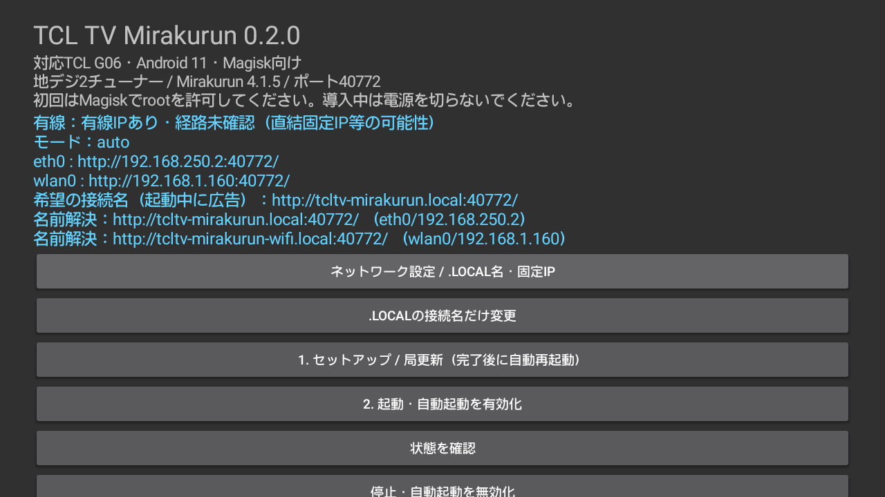
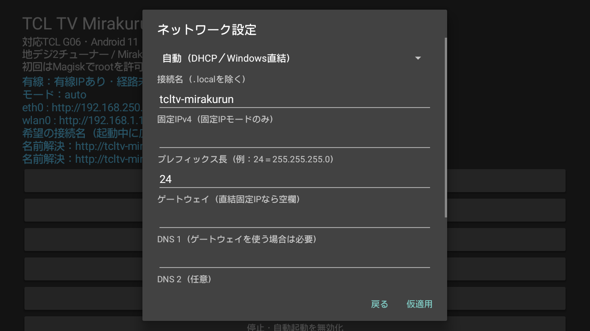

# TCLTV-Mirakurun

## CATVトランスモジュレーション対応（0.3.0-pre.3）・IP変更対策（0.3.0-pre.5）

地デジ端子に接続したCATV（J:COMなど）の64QAM／256QAM（ISDB-C／TSMF）を、内蔵の**2チューナーとも**受信できます。APKの「3. CATVをスキャン・局更新」を押すと、Mirakurunを自動で停止してスキャンし（約5〜10分・進行状況を画面に表示）、局一覧とチューナー設定を更新してMirakurunを再開します。CATVの局はチャンネル種別 `SKY` で登録されます。有料放送は契約とB-CASの条件により映像が出ないことがありますが、局一覧には表示されます。[手順・実機検証範囲](docs/CATV.md)

## BS/110度CS対応プレリリース

**v0.3.0-pre.4 では地デジ・BS・110度CSを同じ2チューナーから選局できます。** フォーク側 0.1-beta の改善（サービス単位のPIDフィルタ・衛星選局の高速化）も取り込み済みで、地デジとCATVの2チューナー同時受信は実機で検証済みです。

[2m3k/TCLTV-Bondriver-3wave](https://github.com/2m3k/TCLTV-Bondriver-3wave)
の衛星選局処理を移植しています。既存の有線優先・DHCP/Windows直結・mDNS修正を維持しています。

- TV本体でBS/CSを受信できるアンテナ・B-CASカードを用意し、TV本体でスキャンしてからアプリのセットアップを実行します。APK更新だけでは既存の局設定や配信本体は更新されません。
- スキャン結果の `TYPE_ISDB_T` はGR、`TYPE_ISDB_S` のONID=4はBS、ONID=6/7はCSとして、物理多重ごとに設定を生成します。
- `tuners.yml` は両チューナーに `[GR, BS, CS, SKY]` を設定します（`SKY` はCATV専用の種別）。配信コマンドへ渡す局指定は従来同様 `ONID_TSID_SID` です。
- 既存BonDriver配信環境を利用している場合も、セットアップで接続キー・ネットワーク・起動設定を保持して共有の配信バイナリーを更新し、TV再起動後に適用します。更新前のバイナリーはTV内のroot専用バックアップへ保存します。
- 未契約局の復号、4K/8K放送は対応範囲外です。Mirakurunの通常のEPG収集・チューナー割り当てを使用します。衛星EPGと同時視聴の動作は実受信環境での検証が必要です。
- **当方にはBS/CSアンテナがないため、BS/CSの実受信と混在同時受信は未検証です。** 地デジの実機回帰試験に加え、地デジとCATVの2チューナー同時受信・復号を実機で検証したプレリリースです。

[3波対応の構成・検証範囲](docs/THREE_WAVE.md)


対応するTCL G06 Android TVの内蔵2チューナーを、TV本体で動く
Mirakurunから利用するセットアップアプリです。PCにMirakurunを常駐させる必要はありません。

**機種・ファームウェア限定の実験版です。** Android TV全般に対応するアプリではありません。
root化・Magisk導入は事前に必要です。本アプリはboot・vbmeta・vendorパーティションを
書き換えません。対応ライブラリーのSHA-256が一致しなければ導入を中止します。

## ダウンロード・導入

[v0.3.0-pre.5（プレリリース）のAPK](https://github.com/Long0823-1/TCLTV-Mirakurun/releases/tag/v0.3.0-pre.5)

1. 対応TVをLANへ接続し、TV本体の地デジ・利用するBS/CSのチャンネルスキャンを完了します。
2. APKをTVへインストールします。ADBの場合は `adb install -r TCLTV-Mirakurun-v0.3.0-pre.5.apk`。
3. TVのアプリ一覧から **TCL TV Mirakurun** を開き、**1. セットアップ / 局一覧を更新** を選択します。
4. Magiskのroot要求を許可します。実行環境を展開するので数分待ちます。
5. 正常に構築できたら、5秒後にTVを自動再起動します。構築エラー時は再起動しません。
6. 再起動後はMirakurunも自動起動します。停止後に手動で再開する場合は **2. 起動・自動起動を有効化** を選択します。
7. 同じLANのブラウザーで、画面に表示された `http://TVのIP:40772/` を開きます。

APKにはARMv7 Linux実行環境、Node.js、Python、Mirakurun 4.3.0を同梱します。
初回セットアップ時にnpm等の追加ダウンロードは行いません。
**Mirakurun本体の更新機能ではインターネットから追加ダウンロードします。** 同梱版は4.3.0、実機で本体更新を確認した版は4.2.1・4.3.0です。
TV用のTCLTV-Bondriver APKを別途入れる必要はありません。
既にネイティブ配信環境が動作している場合は、それを検出して利用します。
既存の起動フック・配信ファイルの存在で判定します。明示的なセットアップ時は、既存の接続キーや起動・ネットワーク設定を保持して3波対応の配信バイナリーを配置します。

本アプリ自身の有線維持処理を同梱しており、BonDriver側アプリの導入は不要です。
通信状態の定期監視では `su` を呼び出しません。常駐する有線維持処理が状態を書き出し、
アプリはそれを読み取ります。起動・設定変更などで必要なroot権限要求は残りますが、
数秒おきにスーパーユーザー許可通知が表示されることはありません。
`eth0` はAndroidのDHCPで自動取得します。ルーターから取得できたアドレスを優先します。
有線リンクがあり、30秒以上DHCPで取得できない場合は、同梱BusyBoxの `zcip` が
ARPで重複を確認して `169.254.x.x/16` を自動選択します。固定の共通IPは使用しません。
WindowsとLANケーブルで直結する場合は、Windows側もIPv4の自動取得を選択してください。
DHCPが使えるようになった場合やケーブルを抜いた場合は、本アプリの自動アドレスを解除します。
接続先はTV画面の現在のIPまたは広告された `.local` 名で確認します。

Windowsとの直結でIPを一定にしたい場合は、対応する **Mirakurun Desktop Setup** の
**Windows直結設定**から、WindowsをTV専用のDHCPサーバーにできます。
TVはDHCPのまま、Windowsから同じIPを受け取ります。専用のプライベート `/30` では、
現在のeth0と同じ2ホスト分の範囲だけをMirakurunの接続許可へ追加します。
既存の許可設定は保持し、一般の外部アドレスや別のネットワークを許可しません。




## 対応条件

- TCL G06 / MT5867、日本向けAndroid 11、32bit ARM。TCL 32S5400系の検証ファームウェア。
- Magisk root、`su`、Android標準のchroot / mount。
- 地デジ、または利用するBS/CSの受信環境とTV本体のスキャン済み局情報。
- `/data` の空き領域1GB以上を推奨。インストール用コピーと展開済み実行環境を保持します。
- PC・視聴端末とTVが同じLANにあること。有線LAN・Wi-Fiの両方で利用できます。

TVに登録された地デジ・BS・110度CSの多重ごとに設定を作成します。地域固定のプリセットは使いません。
サブチャンネル・番組情報はMirakurunが受信ストリームから検出します。
BS/110度CSは実験対応です。衛星の実受信は未検証で、4K/8Kは対象外です。

## 操作と構成

- **セットアップ / 局一覧を更新**: 同梱実行環境の初回展開、局設定、起動フックの配置。
  実行中のMirakurunは停止します。正常完了後は5秒後にTVを自動再起動し、
  Mirakurunも自動で起動します。エラー時は再起動せず表示します。
- **起動**: Mirakurunと通信維持サービスを起動し、次回起動時の自動起動を有効化します。
- **停止**: Mirakurunを止め、自動起動・このアプリの通信維持を無効化します。
  このアプリが追加したTCL常駐許可と電源設定は停止時に復元します。
- **状態 / ログ**: 起動状態、チューナー状態、ネットワーク情報、直近のサーバーログを表示します。
- **環境を削除**: 確認画面の後、Mirakurun本体・設定・番組DB・ログ・自動起動を削除します。
  マウントを解除し、使用中のプロセスや不正なパスがある場合は削除を中止します。
  既存のBonDriver環境は保持します。このアプリが初めてチューナー配信を導入した場合は
  導入前の設定を復元し、TVの再起動を案内します。APK自体は残るため再構築できます。

実行環境: `/data/local/tcl-mirakurun/rootfs`。
設定: 同ディレクトリ内の `/usr/local/etc/mirakurun/{server,tuners,channels}.yml`。
サービス・番組DB: `/usr/local/var/db/mirakurun/`。
ログ: `/data/local/tcl-mirakurun/server.log`。
Magiskフック: `/data/adb/service.d/99-tcl-mirakurun.sh`。

既存のTV配信プロトコルをC製の静的リンクバイナリ（`tcl-tuner`、`vendor/tcl/native/tcl_tuner.c`）のブリッジでMirakurunのチューナーコマンドへ
接続します。TV内の通常の復号処理を使用し、Mirakurun側の追加デコーダーは設定しません。
機器固有の接続キーはTV内だけに保存し、APKやリポジトリには含めません。

## TVアプリからMirakurun本体を更新

アプリの **「Mirakurun本体の更新を確認」** で、インストール済み版・公式npmの最新安定版・Node.js・戻せる版・ライセンスを表示します。
新しい対応版があれば **「本体を更新する」** を選べます。APK自体の更新機能とは別です。

- 更新中は配信を停止し、完了後に再起動します。TV本体の再起動は不要です。視聴・録画中の適用は拒否します（バックグラウンドEPG収集は停止対象）。
- 別ディレクトリへ取得し、npmのSHA-512整合性、Node.js互換性、ARMv7のCRC処理、必要なネットワーク修正を検証してから切り替えます。
- 設定・局一覧・番組DBをバックアップし、起動確認に失敗した場合は旧本体と保存状態へ自動復元します。取得・準備失敗時も旧本体を再起動します。
- **「前の本体に戻す」** は本体と、その本体に対応する設定・DBの保存状態を復元します。更新情報を取得できない場合も、保存済み版への復元は利用できます。
- 対応範囲はMirakurunの安定版4.xです。Node.jsの要件やTV用の修正に適合しない版は適用しません。Node.js・Alpine自体の更新は含みません。
- 512MB以上の空き領域とインターネット接続が必要です。更新中は電源を切らないでください。低メモリー対策としてnpmのヒープを制限しています。
- **「Mirakurun本体・依存パッケージのライセンス」** で本体のLICENSEと、更新時に収集した依存パッケージの版・ライセンス一覧を表示します。各パッケージのLICENSEも実行環境内に保持します。
- 本体更新の結果は **「本体更新のログを表示」** で確認できます。

実機で4.1.5→4.2.1、手動復元、視聴中の拒否、意図的な起動確認失敗からの自動復元を検証しています。
[本体更新の手順・仕様・検証](docs/CORE_UPDATE.md)

## 接続先とネットワーク設定

- 標準は **自動（DHCP／Windows直結）**。ルーターから取得し、未取得時は重複確認後のリンクローカルへ切り替えます。
- `.localの接続名だけ変更` で名前を保存します。初期名には個体識別用の文字列が付きます。TV画面の広告名をそのまま使用してください。
- 有線を基本名、Wi-Fiを `-wifi.local` などの別名で広告します。Windowsセットアップは到達できる有線を優先します。
- **Windows直結設定** は対応するDesktop Setupで行います。TVはDHCPのまま、WindowsがTVの有線MACへ同じIPを配布します。
- 直結かDHCP未取得かはネットワーク情報だけでは断定できないため、画面には推定表示します。
- 手動固定IPは詳細設定です。TVでの確定期限は60秒ですが、実書き込み・期限切れ復元の全条件は未検証です。通常は自動取得を使用してください。



AndroidのブラウザーでIPでは開けるのにWi-Fiの `.local` が `NXDOMAIN` になる場合は、v0.2.1以降へ更新してください。Androidのone-shot mDNS問い合わせへ、送信元の一時UDPポートへ返答するよう修正しています。通常のmDNS検出とQU応答も維持します。

**TVのIPアドレスやルーターのネットワークが変わった後、直IPでも `.local` でも `ERR_EMPTY_RESPONSE`（空の応答）になる場合は、v0.3.0-pre.5以降へ更新し、アプリの「2. 起動・自動起動を有効化」を一度実行してください。** これまでの版は、Mirakurunの接続許可リストを起動時の設定からだけ読んでいたため、DHCPやルーター変更でサブネットが変わると、新しいネットワークからの接続を再起動まで拒否していました。v0.3.0-pre.5では、接続のたびにTVの現在のインターフェースとサブネットを照合して許可する方式へ変更しました（プライベート／リンクローカル範囲に限り、外部アドレスや別サブネットは従来どおり拒否します）。mDNSの `.local` 広告はIP変更へ自動追従します。

v0.3.0-pre.5ではアプリ画面もテレビ操作向けに調整しました。ボタンと文字を大きくし、リモコンの十字キーで選択中のボタンが青色に強調されます。

## 注意・制限

- 各物理チューナーのTS接続は1つです。BonDriver・既存IPTVと同じチューナーを同時利用しないでください。
- 消灯中の通信維持は通常待機より電力を使います。完全な電源断では動作しません。
- 初回のサービス検出・番組表収集には数分以上かかります。受信できない登録局は取得に失敗します。
- LAN内向けです。40772番ポートをインターネットへ直接公開しないでください。
- 標準のネットワークモードは **自動（DHCP／Windows直結）** です。
  **ルーター優先** はDHCPのみ、**固定IP** は利用者が明示的に指定した場合のみ使用します。
  旧版が追加した補助固定IPは自動モードへの移行時に解除します。
  複数の仮想ネットワークがあるWindowsでは、有線インターフェースの経路確認が必要な場合があります。
- 起動後にWi-Fi等のIPが付く場合にも接続できるようIPv4の待受け処理を調整しています。
  MirakurunのLAN内IP・Origin制限は維持しています。
- APKのアンインストールだけではroot領域の実行環境・起動フックは削除されません。
  先に **環境を削除** を実行してください。詳細は [運用手順](docs/OPERATIONS.md) を参照してください。
- 初回導入と既存環境への追加は分岐します。実機で確認した範囲は [検証記録](docs/VALIDATION.md) を参照してください。

## ビルド

Android SDK Platform 35 / Build-Tools 36.0.0、JDK、NDK r29、PowerShellを使用します。
実行環境の作成にはDockerとARMv7のbinfmt/QEMUを使います。

```sh
./scripts/build-runtime.sh
```

```powershell
./scripts/build-native.ps1 -NdkRoot <Android-NDK-folder>
./android/build.ps1 -SdkRoot <Android-SDK-folder> -JdkRoot <JDK-folder>
```

出力は `android/build/TCLTV-Mirakurun.apk`。
署名鍵は `.local/` に生成します。更新版を同じアプリとして導入するには鍵を保持してください。
署名鍵・パスワードはコミットしないでください。
GitHub Actionsの手動実行でもビルドできます。Actionsで生成するAPKは毎回一時的な
署名鍵を使う検証用です。公開リリースAPKとの上書き互換性はありません。
一部環境でのAAPT2/zipalignのZIP終端書込みクラッシュに限り、
`-RecoverAaptZip` を指定できます。修復後はAPK署名検証を行います。

実行環境のnpm依存は同梱のpackage-lockに記録します。Alpineパッケージの更新により
ビルド結果は変わるため、各リリースの実データはSHA-256で識別します。

## 関連プロジェクト・ライセンス

[TCLTV-Bondriver](https://github.com/Long0823-1/TCLTV-Bondriver) のMITライセンスの
ネイティブ配信実装を利用しています。本リポジトリはMirakurunの導入・運用に特化しています。
Mirakurun本体は [Chinachu/Mirakurun](https://github.com/Chinachu/Mirakurun) の
Apache-2.0ライセンスです。自作部分はMIT。
詳細は [THIRD_PARTY_NOTICES.md](THIRD_PARTY_NOTICES.md) を参照してください。

## Support / 開発支援

開発・保守活動をKo-fiで支援できます。

[Ko-fiで支援する](https://ko-fi.com/long0823)

## 関連記事

ブログ「knowledge-storage.info」で関連する解説記事を公開しています。

- [TCL 32S5400でMirakurunを動かす｜内蔵地デジ・CATV・BS/CS チューナーをTVだけで配信する導入手順](https://knowledge-storage.info/2026/10/28/tcl-32s5400-mirakurun/)
